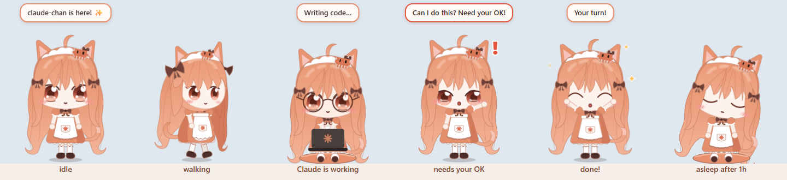

# neko-claude

> chatgpt have pets, so i made clawde :)))

**clawde chan** is a chibi cat-girl who lives on your taskbar and reacts to Claude Code. She sits down at her laptop when Claude works, panics when a command fails, cheers when it's done, and fills the quiet in between with wandering, snacks, naps, window-climbing and the occasional moonwalk.



## Quick start

Needs Node.js 18+.

```bash
npm install
npm start
```

Then hook her up to Claude Code:

```bash
npm run install-hooks:global   # every project (~/.claude/settings.json), recommended
npm run install-hooks          # only this folder (./.claude/settings.local.json)
node install-hooks.mjs --remove [--global]
```

From then on, starting a Claude Code session launches her if she isn't running (`CLAUDE_CHAN_AUTOSTART=0` turns that off). When the last session ends, a tiny **EXIT** door pops up, she waves, turns around and walks in, then waits hidden in the tray. Click the tray icon to call her back any time, no Claude needed; she also comes back on her own the next time Claude does something. **Quit clawde chan** in her menu closes the app for real.

On Windows 11 the tray icon starts in the hidden-icons overflow (^); drag it onto the taskbar to keep it handy.

## While Claude works

| Claude Code | clawde chan |
| --- | --- |
| Session starts | waves hello (and has a coffee, if it's the first one of the morning) |
| You send a prompt | sits on her cushion with the laptop, glasses on, fired up 🔥 |
| A tool runs | types away, eyes on the screen, glancing up at you now and then |
| A tool fails | jolts, sweats and types twice as fast ("Eek! An error!"); a few in a row and she's in tears |
| Something scary (`rm -rf`, `git push --force`, `git reset --hard`…) | "Are you sure about that?! 😰" |
| Tests run / pass / fail | fingers crossed, then "All green! 🟢" or "Red tests… 😭" |
| `git commit` / `git push` | "Committed! ✨" with hearts / "Shipped! 🚀" |
| A failing command passes again | "Fixed it! ✨" |
| Claude needs permission or input | hops and waves with a red **!** until you answer |
| Finished | star eyes and sparkles: "Done! ✨" |
| Session ends | waves bye; after the last one, out through the EXIT door to the tray |

A thought bubble beside her shows what Claude is up to, with a little animated icon (terminal, book, notepad, magnifier, spinning globe, a squad of mini Clawds for subagents, a checklist, a gear), the tool count and the elapsed time. While Claude is still thinking it stretches wider and cycles through little words with a spinning ✻ (*Pondering…*, *Noodling…*, *Clauding…*), the way Claude Code's own spinner does. It turns into a red **?** when Claude needs you and a green ✓ with the totals when it's done.

**She's a little Claude.** Now and then she thinks out loud the way Claude works: reading before touching anything, making small careful changes, running things to check they really work, looking things up instead of guessing. She'd rather ask than guess when Claude needs permission, and she's honest at the finish: if something still failed, she says so instead of just cheering. In quiet moments she muses a bit too ("If I don't know, I'll say so~").

- **Long runs:** after 3 minutes she takes a coffee break; after an hour of coding she holds out a glass of water and tells you to take a break (click her to take it, or she drinks it herself).
- **Out of juice 🪫:** when Claude hits its usage limit she notices (via the `StopFailure` hook and the limit message) and her badge turns into a blinking battery with a countdown to the reset ("2h 14m"). She offers a game while you wait, nudges you to drink water or stretch, warns you not to even *think* about ChatGPT, then naps until the reset (wake her and she mumbles "…is the quota back yet?"). At the reset time she jumps up: "⏰ QUOTA'S BACK! ⚡ Let's gooo!". The countdown survives restarts. Re-run `npm run install-hooks:global` after updating to get the new hook.
- **Mid-air:** if you're holding her when Claude changes status she reacts anyway: typing while dangling, wriggling to be put down when Claude needs you, cheering when it's done.
- **Her little sister:** open a second Claude session while the first is still going and her little sister (blue hair) walks in for it, reacts to that session only, and waves at her big sister now and then. Only one sister at a time. When the sister's session ends she heads home; if clawde chan's session ends first, she takes over her sister's.

## Playing with her

Right-click her (or click the tray icon) for the menu.

- **Pat pat:** click her head and the classic petpet hand pats it, her head squishes and hearts pop out. Keep going and she purrs.
- **Poke:** click her body for a wink. Keep poking and she gets flustered >///<, then pouts 💢, then throws her laptop at you and sulks with her back turned. Three head pats or any treat make up. (If Claude needs her mid-sulk she pulls a spare laptop out of her apron pocket.)
- **Squish, hop, tickle:** click a cheek to squish it, double-click for a hop, wiggle the cursor over her body to tickle her.
- **Boop her nose:** "Boop?!" Boop it twice in a row and she sneezes.
- **Chin scritches:** click under her chin and she tips her head up and purrs; keep going for heart eyes.
- **Ear rubs:** touch an ear and it flicks; wiggle the cursor over it and both ears go flat while she purrs.
- **Grab her tail:** it puffs up like a bottlebrush ("MY TAIL?!"). Do it again and she swats you, hissing.
- **Hold hands:** press and hold on one of her hands, then move: she walks along with your cursor. Let go and she waves.
- **Toss her:** drag her anywhere and let go; she falls with gravity. Grab her mid-air to catch her. Shake her back and forth or swing her round in circles and she gets dizzy, with stars circling her head and a wobble once you set her down.
- **High five ✋:** now and then she holds up a hand. Click her in time; leave her hanging and she's sad about it.
- **Laser pointer 🔴** (menu): a red dot appears at your cursor and she dashes after it and pounces, over and over. She never catches it. Switch it off and she stares at the empty floor.
- **Play fetch 🎾** (menu): a ball flies off and bounces along the floor; she runs after it, carries it back in her mouth and drops it for you. Sometimes she keeps it for a bit first.
- **Rock-paper-scissors ✊** (menu): pick your throw. When she loses she sometimes "changes" hers after the fact, then owns up.
- **I use ChatGPT… 👀** (menu): she's heartbroken ("C-ChatGPT…?! 💔"), storms out through the EXIT door and hides, and the tray icon won't call her back. Switch to the Claude desktop app (or use Claude Code) and she comes running back: "You opened Claude!! ♡ …I forgive you~"
- **Give her…** a cookie 🍪, coffee ☕ (glasses mode), boba 🧋, matcha 🍵, milk 🥛 (milk mustache), water 💧 or a fish 🐟 (her favourite: star eyes and a wildly wagging tail). If she's walking, jumping or chasing something she finishes first, then eats; up on a window or at her laptop she eats sitting down. Four treats in ten minutes and she's stuffed, round belly and all (water doesn't count).
- **Drop a file on her** from Explorer: glasses on, she reads it and tells you its name, line count, size and what she thinks of it. She only counts lines; nothing is shown or sent anywhere.
- **Hide and seek 🙈:** she hides behind a screen edge or ducks behind the taskbar with her ears poking up, giggling now and then as a hint. Click her to find her; she gives up after 90 s, and pops out if Claude needs you.
- **Michael Clawdeson 🕺:** black fedora, black vest and one sparkly white glove. She moonwalks with her chin down and her hand on the brim (always gliding toward open space), spins, and goes up on her toes: "Hee-hee! ✨". Her lines live in `MOONWALK_LINES` in `renderer/app.js` if you want to add your own.
- **Also in the menu:** achievements, wave, dance, do a trick, nap, climb onto a window, call the kitty, *How are you feeling?*, wear glasses, let her wander, sounds, show in taskbar.

## Achievements 🏆

50 of them, from the everyday (**Head Pats**, **Shipped**, **All Green**) to the rarer (**Eagle Eye**: find her in hide and seek within 3 seconds; **Night Owl**: prompt Claude between 2 and 5 am; **Five More Minutes**: wake her in the middle of the night). A gold toast pops up over her head when you unlock one, and the **Achievements 🏆** menu lists them all with what's left to get. Progress is saved in `achievements.json` in the app's user-data folder; the list lives in `ACHIEVEMENTS` in `main.js`.

**Mood:** pats, treats, finding her, finished work and passing tests cheer her up; teasing, errors and being ignored wear her down. A happy clawde chan hums and dances more; a grumpy one mopes and has a shorter fuse. Her mood and the menu toggles are remembered across restarts.

## When Claude is idle

- She wanders along the taskbar, turning to a 3/4 view as she walks, and follows your cursor with her eyes.
- She dances, and now and then does a trick: trips and faceplants (over a banana peel, a pebble, a stray cable, her own tail, or nothing at all), a 360° twirl, a real backflip (side-on crouch, jump, tuck, stuck landing), a sneeze that sends her hairclip flying, or a Michael Clawdeson moonwalk.
- Leave your cursor near her feet and she crouches, wiggles and pounces on it. Leave it still for a while and she may sit on it and ride along when you move it (your clicks go straight through her); flick it fast and she flies off.
- A little grey kitty dashes past sometimes. She chases it. She never catches it.
- After 5 idle minutes she sits and stares into space; after an hour she drags her cushion over and naps. Half an hour in she lies down on it, and half an hour after that she wakes up on her own with a big stretch.
- After 23:00 she's in pajamas and a nightcap and gets sleepy sooner. At bedtime a little bed pops up and she sleeps in it, tucked under a starry blanket, until 8 am, then gets up with a stretch ("Ohayo~ ☀️"). Claude working doesn't wake her (she might mumble "…git push… zzz" in her sleep); only you can. Wake her and she's grumpy ("Five more minutes… 😾"), or between 6 and 8 am "Too early… the sun's barely up… 😾", and she goes straight back to bed.
- Seasonal hats: a witch hat around Halloween (Oct 20 – Nov 2), a Santa hat in December.

### Window climbing (Windows only)

Now and then she leaps onto a window's title bar and sits there swinging her legs; if Claude starts working she stays up there with her laptop.

- **Drag the window up:** she clings on, wide-eyed, and enjoys the elevator ride.
- **Drag it down or sideways:** it slides out from under her. She hangs in mid-air, cartoon style, until you let go of the window, then drops.
- **Maximise it:** it bounces her off. **Minimise or close it:** she drops ("Eh?! It vanished!").
- **Falling past another window:** she lands on it if she was falling gently, or catches its edge from behind (head and hands peeking over) and climbs up like out of a pool. Tossing her at a window works too.

`CLAUDE_CHAN_PERCH=0` turns window climbing off.

## Settings and tweaks

| What | Where |
| --- | --- |
| Don't launch with Claude | `CLAUDE_CHAN_AUTOSTART=0` |
| No window climbing | `CLAUDE_CHAN_PERCH=0` |
| Bridge port (default 47321) | `CLAUDE_CHAN_PORT` |
| Sounds (synthesized blips, no audio files; off by default) | menu → **Sounds** |
| Glasses style: `round`, `half` or `square` | `GLASSES` in `renderer/app.js` |
| Moonwalk lines | `MOONWALK_LINES` in `renderer/app.js` |
| App icon | `assets/icon.svg`, then `npm run build:icon` (regenerates `icon.png`, `tray.png`, `icon.ico`) |

## How it works

The hooks run `hook.mjs`, which forwards each Claude Code event to `127.0.0.1:47321` with a 400 ms timeout. If she isn't running, nothing happens and Claude Code is unaffected.

The same bridge takes her menu commands, handy for scripts and testing:

```bash
curl -X POST --data backflip http://127.0.0.1:47321/command
```

Commands include `hello`, `dance`, `trick`, `backflip`, `moonwalk`, `hide`, `perch`, `kitty`, `mood` and `treat:cookie` (or any other treat).

## Development

```bash
npm run check
```

Parses every script, makes sure no class that `app.js` puts on her (poses, states) is also used by an SVG part (that kind of clash once made her laptop lid see-through), and checks that every element `app.js` looks up exists.

- `main.js`: the transparent, always-on-top Electron windows (her and her sister), tray, menus and the local bridge
- `renderer/index.html`: clawde chan as layered SVG, with front, 3/4 and back views and every part animated separately
- `renderer/style.css`: art styling and every pose and animation
- `renderer/app.js`: behavior: Claude reactions, wandering, physics, tricks, window climbing, idle timers
- `hook.mjs`, `install-hooks.mjs`: the Claude Code side
- `scripts/check.js`: the checks above
- `scripts/windows.ps1`: lists open windows for perching (Windows)

## Credits

Petpet hand frames (`assets/petpet/`) are from [aDu/pet-pet-gif](https://github.com/aDu/pet-pet-gif), ISC license.
